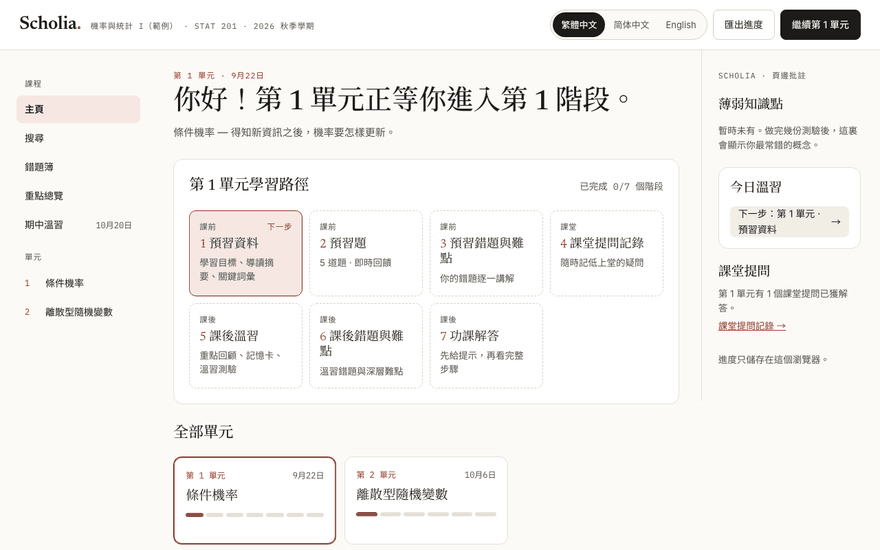
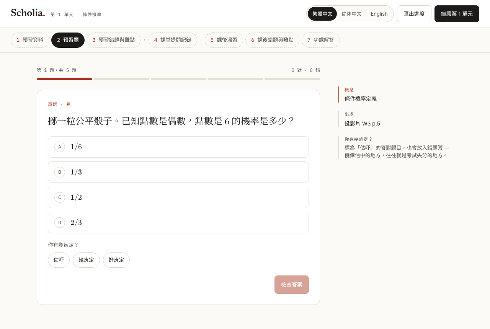
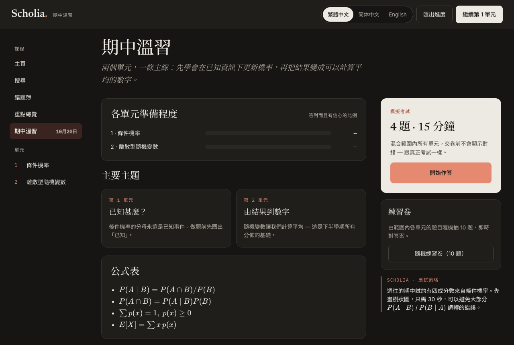
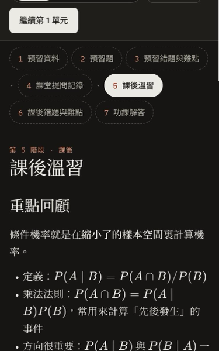
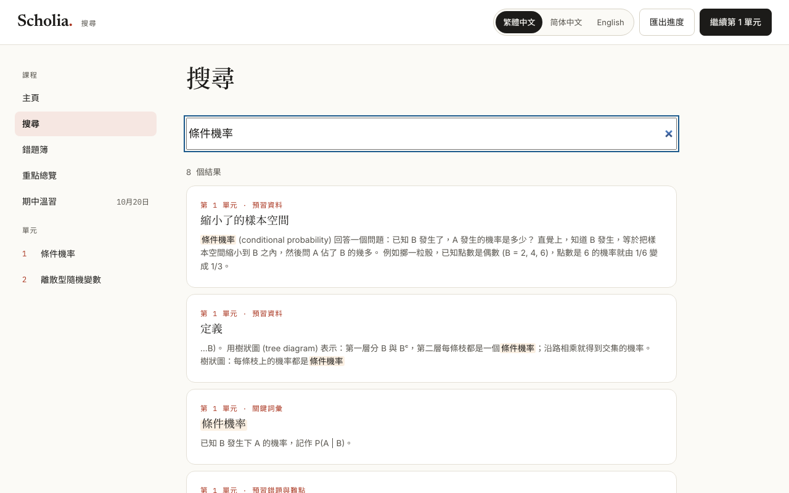
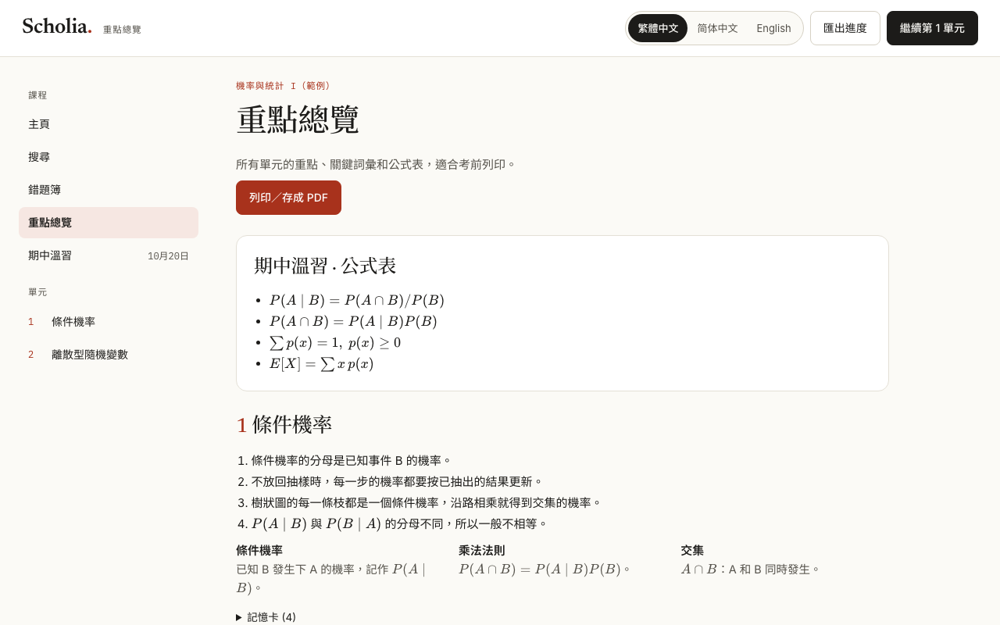

# Scholia

**Turn your course materials into an interactive study site — one Claude skill, one HTML file.**

[繁體中文說明](README.zh-Hant.md) · [Live demo](https://larmeinsamkeit-bot.github.io/scholia-study-skill/) · [Download the skill](../../releases/latest)



*Scholia* (Greek: the notes scholars wrote in the margins of a text) is a [Claude](https://claude.ai)
skill. Give Claude your syllabus, slides, notes, homework and past exams; it reads them, builds a
course map and generates a single self-contained web page that walks you through the whole learning
loop for every unit:

| Before class | In class | After class | End of term |
|---|---|---|---|
| 1 · Pre-study materials<br>2 · Pre-study quiz<br>3 · Pre-study mistakes & difficulties | 4 · Classroom question log | 5 · After-class review (recap, flashcards, quiz)<br>6 · After-class mistakes & difficulties<br>7 · Homework solutions (hints first) | Midterm review<br>Final review (timed mock exam) |

Plus:

- **Mistake notebook with spaced repetition** — wrong answers and flashcards are rescheduled with SM-2; an item counts as mastered once its interval passes three weeks
- **Today's review** — one list of due re-tests and flashcards on the home page
- **Practice sets** — 10 random questions from the review scope, or only from your weak concepts; mock exams are shuffled and scored per concept
- **Confidence ratings** — a right answer marked "guessing" still goes into the notebook
- **Source citations** on every section, question and difficulty
- **Classroom questions → Claude** — log questions in lecture, export them, paste them back to Claude for answers
- **Weak-spot tracking** that feeds the midterm and final reviews
- **繁體中文 / 简体中文 / English** interface; course content in the language(s) you choose
- **Search** across every unit, a printable **study sheet**, and **figures** (diagrams from your slides, embedded in the file)
- **Calendar export (.ics)** of lecture, exam and re-test days, and a weekly **backup reminder**
- **Works fully offline** — math (KaTeX) and fonts are embedded in the file; light and dark mode; phone-friendly
- **Progress stays with you** — saved in your browser; move it to another device with a short progress code

**Try it without installing anything:** open the [live demo](https://larmeinsamkeit-bot.github.io/scholia-study-skill/),
or download [`build/scholia-example.html`](build/scholia-example.html) and open it in your browser — a small
two-unit sample course.

| Pre-study quiz | Midterm review (dark mode) | Phone |
|---|---|---|
|  |  |  |
| **Search** | **Study sheet** | |
|  |  | |

## Install the skill

**Claude Code** (one command each):

```bash
claude plugin marketplace add larmeinsamkeit-bot/scholia-study-skill
```

```bash
claude plugin install scholia@scholia-study
```

**Claude.ai / Claude desktop app, or manual install:**

1. Download **`scholia.skill`** from the [latest release](../../releases/latest) (or from [`dist/`](dist/)).
2. Install it:
   - **Claude.ai / Claude desktop app:** open the file in a chat and click **Save skill**, or go to
     *Settings → Capabilities → Skills* and upload it.
   - **Claude Code:** unzip it into `~/.claude/skills/` so you get `~/.claude/skills/scholia/SKILL.md`.
3. Start a new chat, upload your course materials and say something like
   *"Use Scholia to build me a study site for this course."*

Claude will ask which language(s) to write the content in (each extra language roughly doubles the
work and tokens), then generate the site.

## Build a site yourself

The skill's `scripts/build_scholia.py` (Python 3, no dependencies) validates course data and compiles
it into one HTML file:

```bash
python3 scholia/scripts/build_scholia.py scholia/references/example-course -o my-course.html
```

Course data format: [`scholia/references/data-schema.md`](scholia/references/data-schema.md).
Content quality guide: [`scholia/references/content-guide.md`](scholia/references/content-guide.md).

## Development

```bash
python3 -m unittest discover -s tests -v   # validation, build, headless-Chrome and packaging tests
python3 tools/package_skill.py             # rebuild dist/scholia.skill
python3 evals/grade_course.py COURSE_DIR   # check a generated course against the content guide
```

`evals/evals.json` holds test prompts (with small sample materials in `evals/files/`) for checking the
skill end to end: run a prompt with the skill, then grade the course folder it produced.

The app lives in `scholia/assets/app/` (`index.html`, `styles.css`, `i18n.js`, `app.js`); the build
script inlines them together with KaTeX from `scholia/assets/vendor/`. GitHub Actions runs the tests on
every push.

## Repository layout

```
scholia/                 the skill (SKILL.md, app template, build script, references, example course)
dist/scholia.skill       the packaged skill, ready to install
build/scholia-example.html   the example course, built
docs/                    GitHub Pages demo (index.html = the example course) and screenshots
tests/, tools/, evals/   tests, packaging script, skill evals
design/                  the original Claude Design canvas (5 artboards) the app was built from
```

## A note on course materials

Generated study sites contain material derived from your instructors' slides, homework and exams.
Keep them for your own study; don't publish them without permission.

## License

[MIT](LICENSE)
