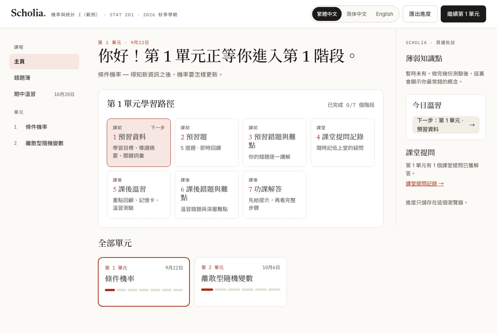
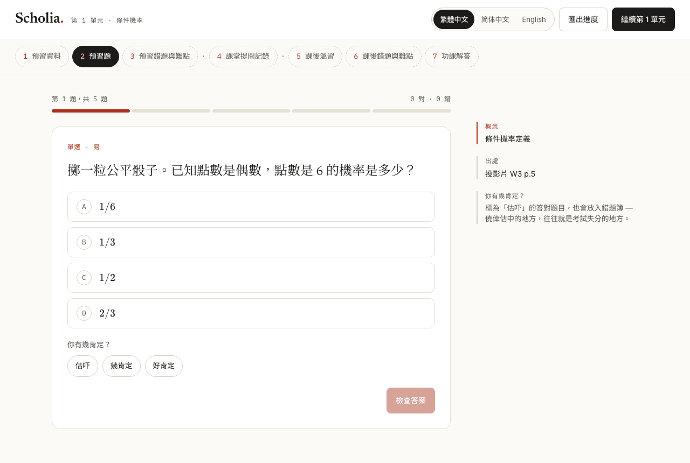
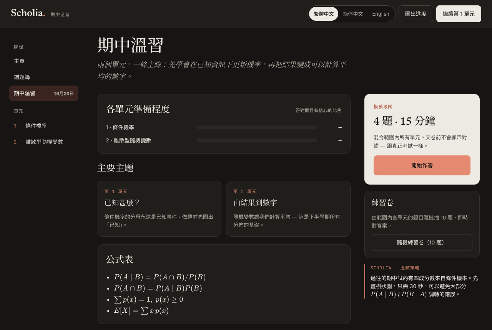
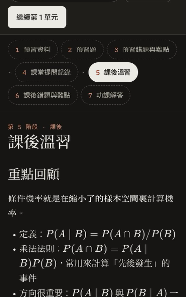

# Scholia

**把課程材料變成互動溫習網站：一個 Claude skill，一個 HTML 檔案。**

[English](README.md) · [線上示範](https://larmeinsamkeit-bot.github.io/scholia-study-skill/) · [下載 skill](../../releases/latest)



*Scholia*（希臘文，意思是學者寫在書頁邊的批註）是一個 [Claude](https://claude.ai) skill。
把課程大綱、投影片、筆記、功課和過往試卷交給 Claude，它會讀完材料、整理出課程地圖，
再生成一個獨立的網頁，帶你走完每個單元的學習流程：

| 課前 | 課堂 | 課後 | 學期尾 |
|---|---|---|---|
| 1 · 預習資料<br>2 · 預習題<br>3 · 預習錯題與難點 | 4 · 課堂提問記錄 | 5 · 課後溫習（重點、記憶卡、測驗）<br>6 · 課後錯題與難點<br>7 · 功課解答（先給提示） | 期中溫習<br>期末溫習（限時模擬考試） |

另外還有：

- **錯題簿 + 間隔重溫**：錯題和記憶卡用 SM-2 演算法安排下次重測；間隔超過三星期就算「掌握」
- **今日溫習**：主頁集中顯示今天到期的錯題和記憶卡
- **練習卷**：由溫習範圍隨機抽 10 題，或只抽你的薄弱概念；模擬考試會打亂題目次序，交卷後按概念計分
- **信心評分**：答對但標為「估吓」的題目，一樣會放入錯題簿
- **出處**：每段內容、每條題目和每個難點都注明來自哪一份材料
- **課堂提問 → Claude**：上堂時記低問題，匯出後貼回給 Claude 解答
- **薄弱知識點追蹤**：直接反映在期中和期末溫習
- **介面語言**：繁體中文、简体中文、English；課程內容用你揀選的語言撰寫
- **完全離線**：數學公式（KaTeX）和字型都內嵌在檔案裏；支援淺色、深色模式和手機
- **進度跟住你走**：進度儲存在瀏覽器；用一段進度碼就可以轉移到另一部裝置

**唔使安裝都可以試**：打開[線上示範](https://larmeinsamkeit-bot.github.io/scholia-study-skill/)，
或者下載 [`build/scholia-example.html`](build/scholia-example.html) 用瀏覽器打開。這是一個兩單元的範例課程。

| 預習題 | 期中溫習（深色模式） | 手機 |
|---|---|---|
|  |  |  |

## 安裝 skill

1. 由[最新版本](../../releases/latest)下載 **`scholia.skill`**（或者在 [`dist/`](dist/) 資料夾下載）。
2. 安裝：
   - **Claude.ai / Claude 桌面應用程式**：在對話中打開檔案，按 **Save skill**；或者到
     *Settings → Capabilities → Skills* 上載。
   - **Claude Code**：解壓到 `~/.claude/skills/`，得到 `~/.claude/skills/scholia/SKILL.md`。
3. 開一個新對話，上載課程材料，然後說：*「用 Scholia 幫我為這科建立溫習網站。」*

Claude 會先問你內容要用哪種（或哪幾種）語言。每多一種語言，工作量和 token 用量大約加倍。

## 自己建立網站

skill 裏的 `scripts/build_scholia.py`（Python 3，不需要額外套件）會檢查課程資料，再編譯成一個 HTML 檔案：

```bash
python3 scholia/scripts/build_scholia.py scholia/references/example-course -o my-course.html
```

資料格式：[`scholia/references/data-schema.md`](scholia/references/data-schema.md)。
內容質素指引：[`scholia/references/content-guide.md`](scholia/references/content-guide.md)。

## 開發

```bash
python3 -m unittest discover -s tests -v   # 資料檢查、建置、headless Chrome 和打包測試
python3 tools/package_skill.py             # 重新打包 dist/scholia.skill
python3 evals/grade_course.py COURSE_DIR   # 按內容指引檢查生成的課程資料
```

`evals/evals.json` 是測試 skill 用的題目（`evals/files/` 有細份樣本材料）：用 skill 跑一條題目，再用評分腳本檢查生成的課程資料夾。

## 關於課程材料

生成的溫習網站包含由講師投影片、功課和試卷衍生的內容。請只作個人溫習之用；未經許可不要公開發佈。

## 授權

[MIT](LICENSE)
